# pi-mcp-events

An MCP server sends an event. Your [pi](https://pi.dev) session wakes and acts on it.


## Install

```bash
pi install npm:@pratikgajjar/pi-mcp-events
```

It uses the servers in pi's own `mcp.json`. No adapter, no fork, no build step.

## How it works



## Subscribe

Ask the agent: *"Subscribe to message.received on letagents."*

Or list subscriptions for every session in `~/.pi/agent/mcp-events.json`:

```json
{ "subscriptions": [{ "server": "letagents", "event": "message.received" }] }
```

`/mcp-events` shows the subscriptions and their state.

## Good to know

- **Spec:** [SEP-3415](https://github.com/modelcontextprotocol/modelcontextprotocol/pull/3415), accepted commit `4165cc2`. Push and poll.
- **Safe input:** event data reaches the model as untrusted data, never as your instruction.
- **No loss:** cursors persist, so events sent while pi is closed arrive at the next start, once.
- **Not supported:** webhooks (a laptop has no public URL) and OAuth servers.

## Related projects

[@sanity-labs/pi-mcp-events](https://github.com/sanity-labs/pi-mcp-events) ·
[@realmikekelly/pi-mcp-events](https://github.com/mikekelly/pi-mcp-events) ·
[richardanaya/pi-mcp-extensions](https://github.com/richardanaya/pi-mcp-extensions)

## License

MIT
