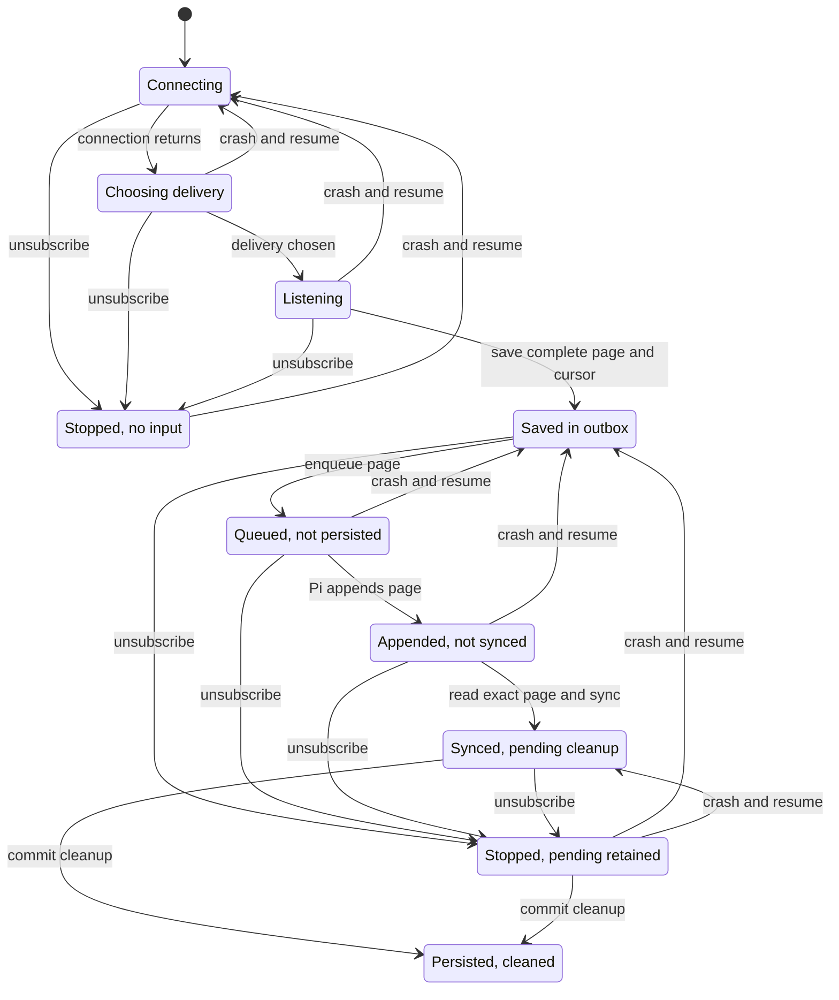

# Delivery model

Run `npm run verify` with Java 11+ installed (`JAVA` can name its binary). The script downloads TLC 1.7.4 and checks its SHA-256. `TLA2TOOLS` can select a local copy of that exact JAR. All TLC state files and source mutations stay in isolated temporary directories. The command prints their path.

## Safety rules

| Rule | Promise | Code boundary |
| --- | --- | --- |
| `AcceptedIsRecoverable` | Accepted input has a pending page or a synced transcript receipt. | `StateStore.accept/flush`, `pump`, `persistedReceipts` |
| `ConsumedIsPersisted` | Cleanup cannot acknowledge a merely queued page. | `persistedReceipts` then `StateStore.acknowledge` |
| `StopFencesStartup` | A stopped subscription cannot create a stream. | `Subscription.run/push/stop` and post-await fences |
| `FailedFlushIsRetryable` | A failed write leaves a staged transaction to retry. | `StateStore.change/flush` |

`AcceptAndSaveOutbox` models the successful atomic rename after file sync; the code does not expose its cursor or enqueue until directory sync returns. `QueuePage` is `pi.sendMessage`, not consumption. `AppendTranscript` is Pi's append after its extension event dispatch. `ReadExactPageAndSyncTranscript` is the disk evidence check, file sync and directory sync; interruption before completion cannot authorize cleanup. `ConfirmPersistedPage` is a separate outbox commit. Crash clears volatile queues and unaccepted staged writes, retains committed outboxes and synced history, and may choose another session/config identity. Locks exclude a second simultaneous owner of one consumer; tests exercise actual SQLite locking.

The full model reaches **6,912 states** at three consumer identities: two sessions on one config and one session on another config, one representative page each. All four invariants and deadlock checks pass. `Chart.cfg` uses one identity and reaches 144 states. Read every TLA+ result with the `statechart` skill; use `view.ts` for its plain-language chart. It hides 489 steps whose labels do not change, chiefly flush staging/failure/retry and resets that remain in the same visible state.

## Counterexamples and real replays

The checker must reject each broken variant. `check.mjs` then makes the related source change in a scratch copy and requires a real regression test to fail. These mutations never touch the working source.

| Broken variant | Shortest model path | Actual-code replay |
| --- | --- | --- |
| `EarlyAck` | Connect, choose delivery, save, queue, acknowledge before append. Both recoverability and persistence fail. | Skip the disk check in `receipt.ts`; the exact-receipt test rejects it. The real Pi subprocess test also proves `message_end` occurs before append and kills there. |
| `LateStart` | Connection returns, unsubscribe, mode returns and starts a stream. | Remove post-await/push fences; real HTTP tests retain a sibling connection and observe forbidden stream creation. |
| `SharedKey` | Save for consumer A, crash/resume as B, reuse A's replay key. | Give all sessions one state filename; real concurrent Pi consumers fail the isolation test. Endpoint replacement is also tested against real requests. |
| `ForgetDirty` | Stage a write, fail flush, forget the staged transaction. | Clear `staged` on write failure; the filesystem fault/retry test rejects it. |

Initial independent source probes reproduced the old implementation's queue loss, shared-key suppression, event 11/tail omission, startup race and failed-flush retry loss. The shipped tests exercise the repaired boundaries with real Pi, actual files, process death and an independent HTTP client.

## Pass chart (one consumer)

This is a finite safety model, not an exactly-once or liveness proof. It abstracts event bytes, quota arithmetic, transport framing, disk hardware, server retention, compaction, branch editing and external actions. Real tests cover multiple events, fragmentation, disk failure, quota backpressure, live config changes, reload/resume and concurrent clients. See [delivery bounds](../docs/durability.md).
